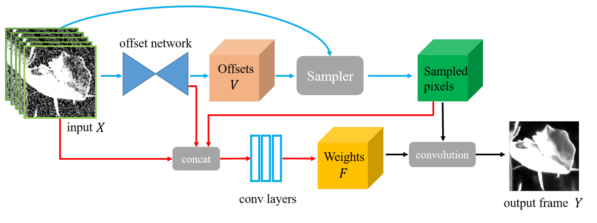
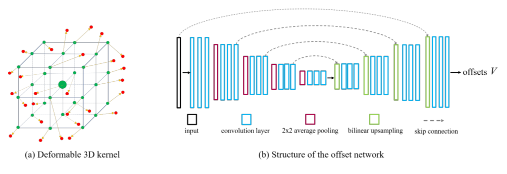
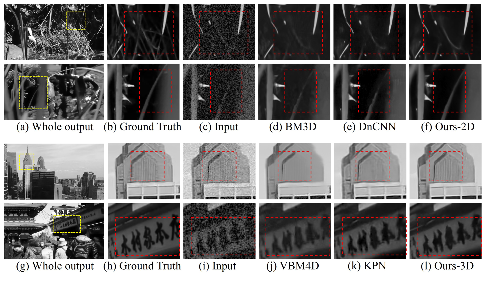
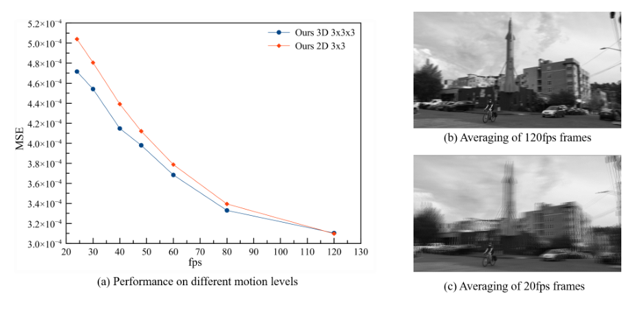
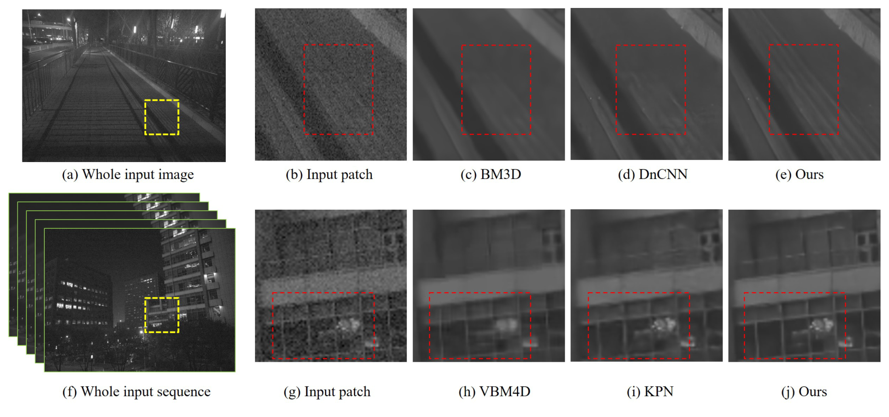
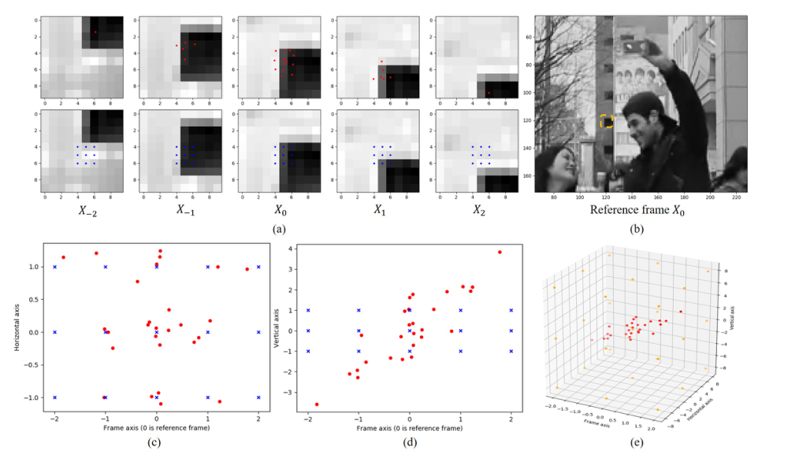

# Learning Deformable Kernels for Image and Video Denoising：学习可变形卷积核进行图像与视频去噪

## 一句话总结

论文把去噪改写为“从哪里取像素 + 如何加权平均”：单帧使用二维可变形核，视频使用三维可变形核，在空间和时间维度上同时预测采样偏移与权重，因此能更好地适应纹理、运动和帧间错位。

## 论文要解决什么问题

传统滤波、`BM3D/VBM4D` 和固定卷积核通常先在固定窗口或匹配块中取样，再做加权平均。固定采样位置在复杂纹理、动态物体和大运动场景下容易取到不可靠像素，表现为过度平滑、重影或边界伪影。

论文研究的问题是：能否让网络直接学习“应该从哪里采样、每个采样值应该占多大权重”，并把这一机制从单帧扩展到视频的空间—时间域？

## 核心方法

### 处理流程

1. 单帧输入使用 `5×5` 二维核；视频输入使用连续 `5` 帧和 `3×3×3` 三维核。
2. 偏移网络采用带跳跃连接的 `U-Net`，为每个输出像素预测采样偏移。
3. 将规则网格与偏移相加得到可变采样位置；二维核使用双线性插值，三维核使用三线性插值。
4. 将采样像素、输入和偏移网络特征拼接，经卷积预测动态权重，最后加权求和得到去噪结果。

_从偏移预测、采样到权重估计和输出重建的整体流程。_

### 二维与三维可变形核

普通加权平均可写为：

$$
Y(y,x)=\sum_{n=1}^{N}X(y+y_n,x+x_n)F(y,x,n).
$$

二维核把规则坐标改为：

$$
\tilde x_n=\hat x_n+V(y,x,n,1),\qquad
\tilde y_n=\hat y_n+V(y,x,n,2).
$$

视频核进一步预测时间坐标：

$$
Y(y,x)=\sum_{n=1}^{N'}X(y+y_n,x+x_n,t_n)F(y,x,n).
$$

因此，模型既能沿图像边缘和纹理方向移动采样，也能从邻帧中寻找与当前结构对应的像素。三线性插值使空间和时间采样都可以反向传播。

_三维可变形核和偏移网络结构。_

### 训练目标

图像去噪使用伽马校正后的 `L1` 损失：

$$
l(Y,Y_{gt})=\|\phi(Y)-\phi(Y_{gt})\|_1.
$$

视频训练把采样点分成若干组，对每组加入退火辅助损失：

$$
l(Y,Y_{gt})+\eta\gamma^p l(Y_i,Y_{gt}),
$$

其中 $\eta=100$、$\gamma=0.9998$。训练初期各组被迫独立探索不同的空间—时间位置，后期正则衰减，让采样组协同工作；去掉该项时，采样点容易全部集中在参考帧附近。

## 数据与实验设置

- 视频数据：27 段互联网高清视频，23 段训练、4 段测试；约 20K 个连续 5 帧训练序列。
- 合成噪声：信号相关高斯噪声，噪声参数分别从 $\sigma_s\in[10^{-4},10^{-2}]$、$\sigma_r\in[10^{-3},10^{-1.5}]$ 采样。
- 训练：`128×128` 裁剪，`Adam`，batch size `32`，训练 `2×10^5` 次迭代，初始学习率 `2×10^{-4}`。
- 评测：`PSNR/SSIM`，并测试真实手机图像、真实视频、时序稳定性和大运动场景。
- 大运动实验：在 `Adobe240` 中从 `240 fps` 下采样到 `120/80/60/48/40/30/24 fps`，每个子集包含 180 个序列。

## 关键结果

### 合成单帧结果

四个测试子集平均结果如下，低噪声为 $\sigma_s=2.5\times10^{-3},\sigma_r=10^{-2}$，高噪声为 $\sigma_s=6.4\times10^{-3},\sigma_r=2\times10^{-2}$。

| 方法 | 低噪声 PSNR / SSIM | 高噪声 PSNR / SSIM |
|---|---:|---:|
| `DnCNN` | 35.88 / 0.9482 | 32.91 / 0.9121 |
| `KPN` 5×5 | 35.82 / 0.9499 | 32.94 / 0.9151 |
| `Ours-2D` | **36.01 / 0.9511** | **33.13 / 0.9183** |

### 合成视频结果

| 方法 | 低噪声 PSNR / SSIM | 高噪声 PSNR / SSIM |
|---|---:|---:|
| `VBM4D` | 34.27 / 0.9367 | 31.40 / 0.8947 |
| `KPN` 5×5 | 36.37 / 0.9592 | 33.72 / 0.9320 |
| `Ours-2D` | 36.62 / 0.9590 | 33.94 / 0.9315 |
| `Ours-3D` | **36.91 / 0.9622** | **34.23 / 0.9366** |

盲噪声设置下，`Ours-3D` 仍达到 `36.55 / 0.9594`（低噪声）和 `33.92 / 0.9319`（高噪声）。三维核的优势主要出现在跨帧错位更明显的场景。

_合成单帧和视频数据上的视觉对比。_

### 消融与大运动

| 变体 | 低噪声 PSNR / SSIM | 高噪声 PSNR / SSIM |
|---|---:|---:|
| direct | 35.45 / 0.9518 | 32.71 / 0.9200 |
| 去掉动态权重 | 35.50 / 0.9449 | 32.60 / 0.9058 |
| 固定 `3×3×3` 核 | 36.02 / 0.9555 | 33.33 / 0.9256 |
| 去掉退火项 | 36.16 / 0.9601 | 33.48 / 0.9341 |
| 完整 `3×3×3` 模型 | **36.91 / 0.9622** | **34.23 / 0.9366** |

动态权重决定“怎么平均”，可变形偏移决定“从哪里取”，退火项决定“是否真正利用时间维度”。在 `Adobe240` 中，帧率越低、运动越大，`3D` 核相对 `2D` 核的优势越明显。

_不同运动强度下二维核与三维核的误差比较。_

### 真实数据与速度

- 真实手机图像和视频中，本文方法能保留细小边缘并减轻动态边界重影。
- 连续 60 帧的时序剖面更稳定，说明模型不仅提升单帧指标，也能减少闪烁。
- 在 `GTX 1060` 上速度约为 `0.27 megapixels/s`；论文同时指出，不同实现的预处理和硬件口径并不完全一致。

_手机实拍图像和视频序列上的定性结果。_

_学习到的采样核沿局部图像结构分布。_

## 论文结论与边界

论文的主要贡献不是简单增加网络深度，而是把去噪中的“采样位置”和“平均权重”显式建模。二维可变形核适应单帧结构，三维可变形核进一步在空间和时间上寻找可靠像素，因此在大运动视频中比固定核更不容易产生重影。

实验的定量结论主要来自合成的信号相关高斯噪声，真实数据以定性结果为主；主实验还以灰度输入为主，彩色结果只作补充。偏移网络和三线性采样会增加显存与计算开销，论文也没有系统报告不同硬件、分辨率和采样点数量下的复杂度变化。

## 复现与使用要点

- 区分单帧 `5×5` 核和视频 `3×3×3` 核，视频输入为同一位置的连续 5 帧。
- 非盲实验需要额外输入噪声参数；盲实验不能直接复用非盲设置。
- 保留分组辅助损失和退火系数，否则采样点可能塌缩到参考帧。
- 评测速度时分开统计偏移网络、三线性采样、权重预测和总耗时。
