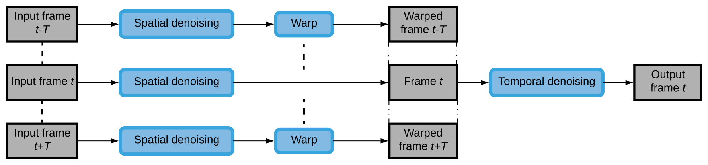
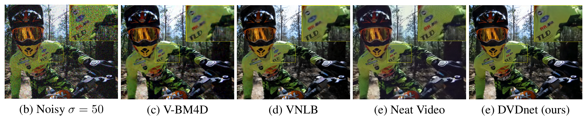

# DVDnet：一种快速的深度视频去噪网络

## 一句话总结

DVDnet 采用“逐帧空间去噪 → 邻帧光流配准 → 时间融合”的两阶段流程，并把噪声标准差作为噪声图输入，使一个轻量 CNN 覆盖 $\sigma\in[0,55]$ 的高斯噪声，在中高噪声下取得接近或超过强传统方法的质量，同时显著降低运行时间。

## 论文要解决什么问题

视频去噪既要恢复单帧细节，又要利用相邻帧抑制闪烁。V-BM4D、VNLB 等传统方法质量较强，但图像块搜索、匹配和运动处理成本高；早期神经网络方法又没有充分利用时序信息。

论文研究的问题是：能否用一个低内存、支持多噪声水平的网络，在保持时序一致性的同时，把视频去噪速度提高到可用范围？

退化模型为：

$$
\tilde I = I + N,
$$

其中 $N$ 是标准差为 $\sigma$ 的零均值白高斯噪声。

## 核心方法

### 处理流程

1. 以目标帧为中心取连续 5 帧，并为每帧附加噪声图。
2. 空间去噪器 $F_{\mathrm{spa}}$ 独立处理每一帧，通过预测噪声残差得到预去噪结果。
3. 对 4 个邻帧估计相对中心帧的光流，并把预去噪后的邻帧配准到中心帧坐标系。
4. 将 5 个对齐帧送入时间去噪器 $F_{\mathrm{temp}}$，输出中心帧的最终结果。

_DVDnet 的整体处理流程。_

### 网络设计

- 空间模块 12 层卷积，时间模块 6 层卷积，特征宽度为 96。
- 使用 $3\times3$ 卷积、ReLU、残差学习和四分之一分辨率计算，再恢复到原分辨率。
- 噪声图同时输入空间模块和时间模块，让同一个模型感知当前噪声强度。
- 两个模块分开训练：先训练空间模块，再用其输出构造时间模块的输入。

空间模块预测噪声残差：

$$
\hat N=F_{\mathrm{spa}}(\tilde I;\theta_{\mathrm{spa}}),\qquad
\hat I=\tilde I-\hat N.
$$

空间模块和时间模块都使用均方误差训练。

## 数据与实验设置

- 空间模块：Waterloo Exploration Database，随机裁剪 1,024,000 个 $50\times50$ 图像块。
- 时间模块：DAVIS 训练集，450,000 个连续 5 帧样本，图像块为 $44\times44$。
- 测试集：Set8 和 DAVIS-test。
- 对比方法：VNLB、V-BM4D；定性结果还比较 Neat Video。
- 噪声：标准差 $\sigma=10,20,30,40,50$，训练范围为 $0$ 到 $55$。
- 训练：Adam，80 轮，batch size 128；学习率从 $10^{-3}$ 分阶段降到 $10^{-6}$。

## 关键结果

### 质量

| 测试集与噪声 | DVDnet | VNLB | V-BM4D |
|---|---:|---:|---:|
| Set8, $\sigma=10$ | 36.08 | **37.26** | 36.05 |
| Set8, $\sigma=20$ | 33.49 | **33.72** | 32.19 |
| Set8, $\sigma=30$ | **31.79** | 31.74 | 30.00 |
| Set8, $\sigma=50$ | **29.56** | 29.24 | 27.33 |
| DAVIS, $\sigma=10$ | 38.13 | **38.85** | 37.58 |
| DAVIS, $\sigma=30$ | **34.08** | 33.73 | 31.65 |
| DAVIS, $\sigma=50$ | **31.85** | 31.13 | 28.80 |

结论很明确：低噪声时 VNLB 略强，DVDnet 还有过度去噪倾向；当 $\sigma\ge30$ 时，DVDnet 在两套测试集上都超过 VNLB，并明显优于 V-BM4D。

### 视觉质量

在 $\sigma=50$ 的示例中，DVDnet 的序列 PSNR 为 26.62 dB，VNLB 为 26.34 dB，V-BM4D 为 24.91 dB。DVDnet 对文字区域保留更清晰，平坦区域的闪烁也较低。

_当 $\sigma=50$ 时不同方法的视觉结果。_

### 速度

在 $960\times540$ 彩色帧上：

| 方法 | V-BM4D | VNLB | DVDnet（CPU） | DVDnet（GPU） |
|---|---:|---:|---:|---:|
| 每帧时间（秒） | 156 | 420 | 19 | 8 |

DVDnet 的 GPU 时间约为 V-BM4D 的二十分之一、VNLB 的五十分之一。不过 8 秒中约 6 秒用于 DeepFlow 运动补偿，真正的主要瓶颈是配准，而不是卷积网络。

## 论文结论与边界

DVDnet 的优势来自系统分解：先降低单帧噪声，再在较干净的帧上做运动对齐和时序融合。噪声图提供了一个简单的条件化接口，使一个模型覆盖多个噪声水平；低分辨率计算和前馈卷积则降低了内存与计算开销。

但论文只验证了 AWGN，低噪声下仍可能过度去噪；论文没有系统消融噪声图、光流、低分辨率和残差连接的独立贡献。速度比较还存在口径差异：VNLB 的表中不包含运动估计时间，因此不能直接把表格数字当作完全对称的端到端延迟。

## 复现与使用要点

- 按“先空间、后时间”的顺序训练。
- 保持 5 帧窗口、空间块 $50\times50$、时间块 $44\times44$ 和噪声范围 $0$ 到 $55$。
- 评测时分开报告网络推理、光流估计、配准和总时间。
- 若要扩展到真实噪声，需要重新验证噪声图语义、光流稳定性和低噪声过度去噪问题。
