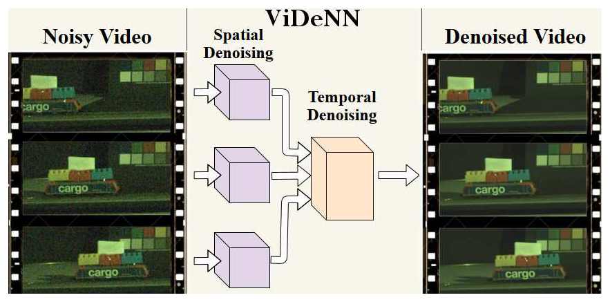
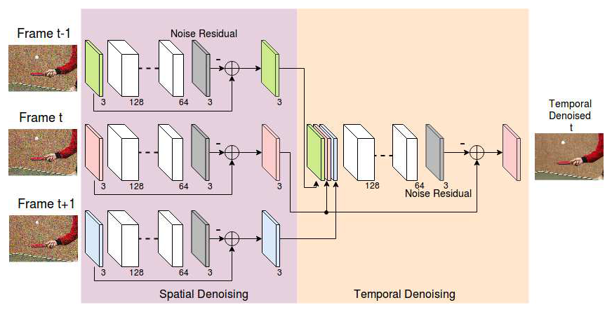
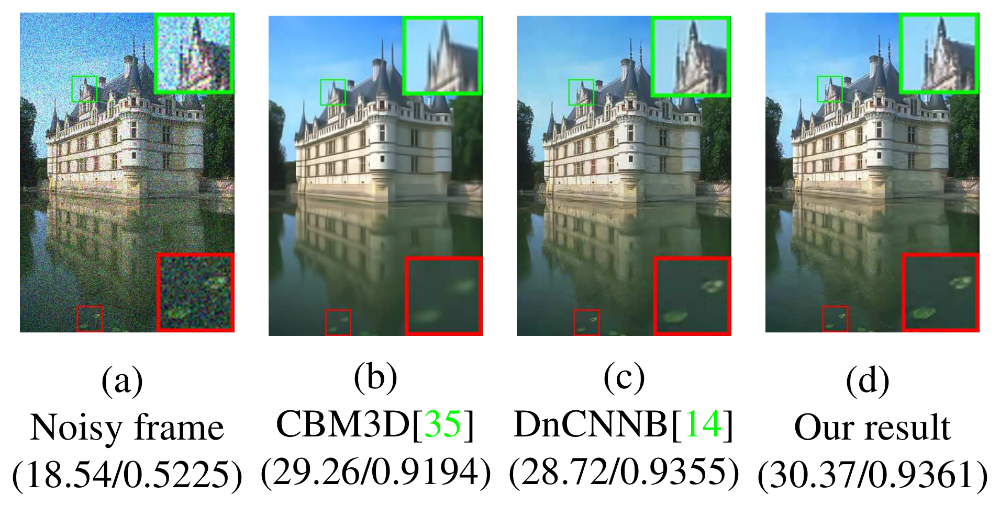
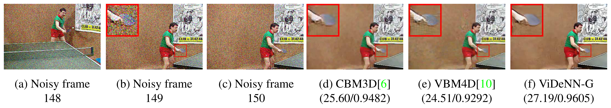
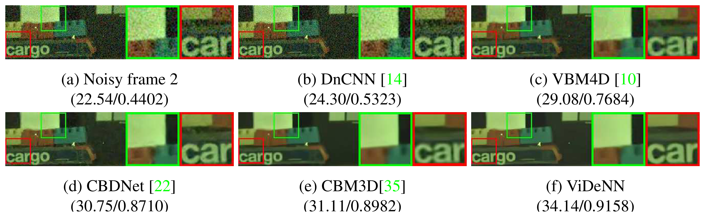

# ViDeNN：深度盲视频去噪

## 一句话总结

ViDeNN 采用“逐帧空间去噪 → 三帧时间融合”的两阶段流程，通过混合 AWGN、信号相关合成噪声和真实低照度数据训练，在不输入噪声类型或强度的情况下完成盲视频去噪。

## 论文要解决什么问题

视频去噪需要同时处理单帧细节、帧间运动和亮度变化。只用 AWGN 训练的图像去噪网络在真实低照度噪声上泛化较差；传统视频方法还依赖块匹配和复杂的时序搜索，速度与部署成本较高。

论文研究的问题是：能否用一个前馈 CNN，在不知道噪声分布和噪声强度的情况下，联合利用空间和时间信息，同时避免运动不一致造成的重影？

## 核心方法

### 处理流程

1. 对连续三帧分别使用 Spatial-CNN，预测每帧的噪声残差并减去残差。
2. 将三张空间去噪后的 RGB 帧沿通道堆叠为 $H\times W\times9$。
3. 使用 Temp3-CNN 融合三帧信息，输出中心帧的噪声残差。
4. 从空间去噪后的中心帧减去时间网络预测的残差，得到最终结果。

_ViDeNN 由逐帧 Spatial-CNN 和三帧 Temp3-CNN 组成。_

_Spatial-CNN 先处理三帧，Temp3-CNN 再融合空间去噪结果。_

### 网络设计

- Spatial-CNN 深度为 20 层，首层有 128 个特征图，使用 ReLU、批归一化（BN）和残差学习。
- Temp3-CNN 与空间网络具有相同的层数和特征宽度，改用 LeakyReLU、不使用 BN；去掉 BN 后去噪耗时约减少 5%，PSNR 没有下降。
- 两个网络都用 L2 损失学习噪声残差；不显式估计光流，也不需要输入噪声强度图。

### 噪声模型

普通高斯噪声写为：

$$
Y=X+N.
$$

真实低照度噪声包含光子散粒噪声和读出噪声。论文用以下信号相关模型生成合成噪声：

$$
M(s)=\sqrt{\frac{Ag\cdot Dg}{N_{\mathrm{sat}}\cdot s} + Dg^2(Ag\cdot CT1_n+CT2_n)^2}
$$

$$
Y=s+N(0,1)\cdot M(s).
$$

其中 $s$ 为干净图像，模拟增益 $Ag\in[0,64]$、数字增益 $Dg\in[0,32]$；$N_{\mathrm{sat}}=7489$ 为传感器饱和电子数，$CT1_n$、$CT2_n$ 为读出噪声参数。该模型与 AWGN、真实低照度图像共同用于训练。

## 数据与实验设置

- 空间数据：Waterloo 的 4,744 张图像按 70%/30% 划分训练与测试；一半加 AWGN（$\sigma\in[0,55]$），一半加上述信号相关噪声。训练集生成 120,000 个图像块，另加入自建低照度数据的 80,000 个和 RENOIR T3 的 40,000 个图像块，尺寸均为 $50\times50\times3$。
- 空间训练：Adam，100 轮，batch size 128；前 20 轮学习率 $10^{-3}$，后 80 轮为 $10^{-4}$。
- 时间数据：31 段公开视频、8,922 帧、2,974 个三帧序列，生成 300,032 个 $50\times50\times9$ 图像块；先加同样两类合成噪声，再经训练好的 Spatial-CNN 处理，构造时间网络输入。
- 时间训练：Adam，60 轮，batch size 128，学习率 $10^{-4}$；在空间网络收敛后单独训练。
- 低照度数据：Bosch Autodome IP 5000 IR 摄像机拍摄静态场景，12 档光照、每档 200 张 raw 图像，求平均作为参考；另用定格拍摄构造 6 段三帧或四帧测试序列，每个时刻同样采集 200 张来构建参考。这些测试场景不参与训练。

## 关键结果

### 单帧去噪

CBSD68 上的 PSNR（dB）：

| 方法 | $\sigma=5$ | $\sigma=10$ | $\sigma=15$ | $\sigma=25$ | $\sigma=35$ | $\sigma=50$ |
|---|---:|---:|---:|---:|---:|---:|
| Spatial-CNN* | 39.73 | 35.92 | 33.66 | 30.99 | 29.34 | 27.63 |
| DnCNN-B* | 39.79 | 35.87 | 33.57 | 30.69 | 28.74 | 26.53 |
| DnCNN-B | 40.62 | 36.14 | 33.88 | 31.22 | 29.57 | 27.91 |

星号表示噪声图像被裁剪到 $[0,255]$；无星号行的预处理条件不同。相同裁剪条件下，Spatial-CNN 与 DnCNN-B 在低噪声下相近，在中高噪声下更好。

DND 真实噪声图像基准：

| 方法 | PSNR（dB） | SSIM |
|---|---:|---:|
| Spatial-CNN | 37.0343 | 0.9324 |
| CBDNet | **38.0564** | 0.9421 |
| DnCNN+ | 37.9018 | **0.9430** |
| FFDNet+ | 37.6107 | 0.9415 |
| BM3D | 34.51 | 0.8507 |

Spatial-CNN 优于 BM3D，但仍低于表中的 CBDNet、DnCNN+ 和 FFDNet+，不能据此称其为最优真实图像去噪方法。

_CBSD68 图像在 $Ag=64$、$Dg=4$ 的信号相关合成噪声下的结果；Spatial-CNN 达到 30.37 dB / 0.9361 SSIM。_

### 空间与时间模块消融

合并论文表 3–5，数值为 PSNR（dB）：

| 结构 | Foreman $\sigma=25$ | Foreman $\sigma=55$ | Tennis $\sigma=25$ | Tennis $\sigma=55$ | Strijp-S $\sigma=25$ |
|---|---:|---:|---:|---:|---:|
| Spatial-CNN | 32.18 | 28.27 | 29.46 | 26.15 | 32.73 |
| Temp3-CNN 单独使用 | 31.56 | 27.45 | 29.32 | 25.63 | 31.13 |
| Temp3 → Spatial | 32.09 | 28.37 | 29.21 | 25.98 | 32.28 |
| Spatial → Temp3 | **33.12** | 29.56 | 30.36 | 27.18 | **34.07** |
| Spatial → Temp5 | 33.03 | **29.87** | **30.72** | **27.70** | 33.97 |

单独用时间网络不如空间网络；“先空间、后时间”在五种设置中都提升了质量，反向顺序则不稳定。五帧也未稳定优于三帧，处理 Foreman 整段视频的 GPU 耗时从 19.85 s 增加到 21.17 s（约 6.5%），因此最终采用三帧。

时序不一致实验中，作者移除 Tennis 第 9、11 帧中的白球，再去噪第 10 帧；正常和修改后的输入都得到 27.28 dB，且保留中心帧的球。这支持模型能在该例中排除不一致信息，但不是对所有运动或场景切换的保证。

### AWGN 视频去噪

论文表 6 的全部序列结果，PSNR（dB）。ViDeNN-G 仅针对 AWGN 训练，ViDeNN 使用混合噪声训练。

| 视频 | $\sigma$ | ViDeNN | ViDeNN-G | VBM4D | CBM3D | DnCNN |
|---|---:|---:|---:|---:|---:|---:|
| Tennis | 5 | 35.51 | **37.81** | 34.64 | 27.04 | 35.49 |
| Tennis | 25 | 29.97 | **30.36** | 29.72 | 26.37 | 27.47 |
| Tennis | 40 | 28.00 | **28.44** | 27.49 | 25.62 | 25.43 |
| Old Town Cross | 15 | 32.15 | 32.39 | **32.40** | 28.19 | 31.47 |
| Old Town Cross | 25 | 30.91 | **31.29** | 31.21 | 27.95 | 30.10 |
| Old Town Cross | 40 | 29.41 | **29.97** | 29.57 | 27.35 | 28.35 |
| Park Run | 15 | 31.04 | **31.25** | 29.99 | 24.75 | 30.66 |
| Park Run | 25 | 28.44 | **28.72** | 27.90 | 24.46 | 27.87 |
| Park Run | 40 | 25.97 | **26.36** | 25.84 | 23.71 | 25.20 |
| Stefan | 15 | 32.06 | **32.37** | 29.90 | 26.19 | 32.20 |
| Stefan | 25 | 29.23 | **29.59** | 27.87 | 25.89 | 29.29 |
| Stefan | 55 | 24.63 | **25.06** | 23.83 | 24.18 | 24.51 |

ViDeNN-G 在 12 种设置中的 11 种最好，混合噪声模型略有质量损失。比较条件需注意：VBM4D 因内存限制使用低复杂度配置并启用噪声估计；CBM3D 固定假定 $\sigma=50$；DnCNN 使用作者提供的盲模型，因此并非各方法都使用准确噪声水平的对称比较。

_Tennis、$\sigma=40$，前后帧发生视角变化。第 149 帧的 PSNR/SSIM：CBM3D 25.60/0.9482，VBM4D 24.51/0.9292，ViDeNN-G 27.19/0.9605；这些是单帧指标，与上表的序列指标不同。_

### 低照度视频

论文表 7 的全部六段序列结果，PSNR（dB）：

| 序列与光照 | ViDeNN | VBM4D | CBDNet | CBM3D | DnCNN |
|---|---:|---:|---:|---:|---:|
| Train，50/255 | **34.05** | 29.10 | 30.89 | 31.27 | 24.33 |
| Train，55/255 | **36.96** | 33.48 | 34.56 | 34.06 | 29.87 |
| Mountains，$[55,75]/255$ | **40.84** | 37.34 | 39.91 | 40.20 | 32.39 |
| Windmill，44.6 lux | **32.96** | 26.62 | 29.56 | 29.81 | 21.73 |
| Windmill，118 lux | **35.42** | 30.69 | 34.31 | 34.06 | 25.55 |
| Windmill，212 lux | **36.69** | 32.92 | 36.22 | 35.74 | 27.87 |

ViDeNN 在六段序列上均领先，较暗条件下优势更明显，支持混合噪声训练与时间融合在该相机数据上的有效性；实验未单独隔离两者对低照度性能的贡献。

_Train、50/255 光照下第 2 帧的 PSNR/SSIM：ViDeNN 为 34.14/0.9158。图中各数值均为单帧结果，不能与上表的整段序列指标混用。_

## 论文结论与边界

ViDeNN 的关键在于先降低单帧噪声，再由时间网络融合邻帧。消融支持这种顺序优于直接三帧去噪；混合噪声训练扩大了适用范围，但在纯 AWGN 上仍略逊于专门训练的版本。

设计目标是静态安防摄像头，论文不处理相机运动。计算量仍是部署瓶颈：Nvidia Titan X 上 HD 视频最高约 3 fps，尚未验证移动端部署。真实低照度视频仅有同一相机采集的六段定格短序列，参考图像依赖重复拍摄求平均，不能直接推广到连续快速运动或其他传感器。

## 复现与使用要点

- 按“先训练 Spatial-CNN，再固定其输出训练 Temp3-CNN”的顺序实现。
- 保持三帧输入、中心帧输出和残差学习；Temp3-CNN 不使用 BN。
- 训练数据同时加入 AWGN 与信号相关噪声，增益范围使用 $Ag\in[0,64]$、$Dg\in[0,32]$。
- 评测时分别报告空间模块、时间模块和总耗时；三帧模型是质量、显存和速度之间的折中。
- 若扩展到手持或移动摄像机，需要额外处理全局运动，并重新验证时间融合是否会产生重影。
